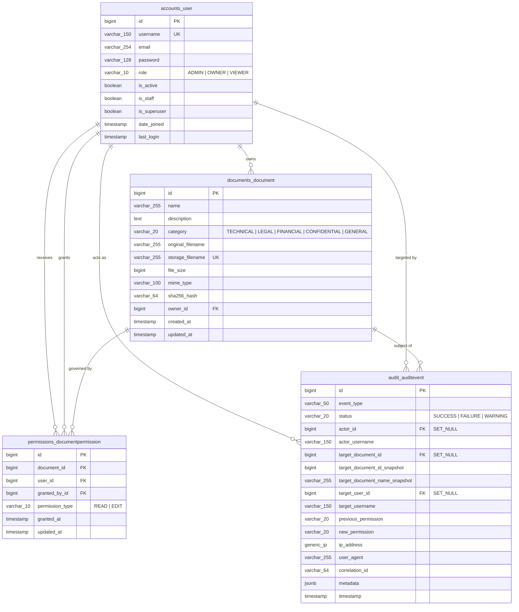

# TrustVault — Database Schema & Data Architecture Specification

**Project:** TrustVault — Secure Document Sharing with a Real Audit Trail
**Database Engines:** SQLite (Local Development) / PostgreSQL 14+ (Production)
**Schema Architecture:** Fully Normalized Relational Model with Append-Only Audit Trail

---

## 1. Entity-Relationship Diagram (ERD)

---

## 2. Model Specifications & Column Definitions

### 2.1 Table: `accounts_user`
Inherits from Django's `AbstractUser`, customized with mandatory role separation.

| Column Name | Data Type | Nullable | Constraints & Indexes | Description |
| :--- | :--- | :--- | :--- | :--- |
| `id` | `BigAutoField` | No | Primary Key | Unique user identifier |
| `username` | `VarChar(150)` | No | Unique, Indexed | Login username |
| `email` | `EmailField(254)` | No | Indexed | User email address |
| `password` | `VarChar(128)` | No | — | PBKDF2 with SHA-256 password hash |
| `role` | `VarChar(10)` | No | Choice (`ADMIN`, `OWNER`, `VIEWER`) | Platform role |
| `is_active` | `BooleanField` | No | Default: `True` | Account activation flag |
| `is_staff` | `BooleanField` | No | Default: `False` | Administrative access flag |
| `is_superuser`| `BooleanField` | No | Default: `False` | Superuser administrative flag |
| `date_joined` | `DateTimeField`| No | Auto-set | Timestamp account was registered |
| `last_login` | `DateTimeField`| Yes | — | Timestamp of most recent authentication |

---

### 2.2 Table: `documents_document`
Tracks secure document metadata while decoupling from disk storage.

| Column Name | Data Type | Nullable | Constraints & Indexes | Description |
| :--- | :--- | :--- | :--- | :--- |
| `id` | `BigAutoField` | No | Primary Key | Unique document identifier |
| `name` | `VarChar(255)` | No | Indexed | Human-readable title |
| `description` | `TextField` | No | Blank permitted | Optional document description |
| `category` | `VarChar(20)` | No | Indexed, Choice | Domain classification category |
| `original_filename`| `VarChar(255)`| No | — | Sanitized original client filename |
| `storage_filename` | `VarChar(255)`| No | Unique, Indexed | Cryptographic UUID on private disk (`<uuid4>.bin`) |
| `file_size` | `PositiveBigInt`| No | Indexed | Size in bytes |
| `mime_type` | `VarChar(100)` | No | Indexed | Validated MIME type |
| `sha256_hash` | `VarChar(64)` | No | Indexed | SHA-256 cryptographic checksum |
| `owner_id` | `BigInt` | No | Foreign Key -> `accounts_user(id)` | Document Owner |
| `created_at` | `DateTimeField`| No | Auto-now-add, Indexed | Creation timestamp |
| `updated_at` | `DateTimeField`| No | Auto-now | Last metadata modification timestamp |

#### Composite Indexes & Constraints
- `indexes = [models.Index(fields=['owner', 'created_at']), models.Index(fields=['category', 'name'])]`

---

### 2.3 Table: `permissions_documentpermission`
Normalizes object-level permission grants between Document Owners and Recipients.

| Column Name | Data Type | Nullable | Constraints & Indexes | Description |
| :--- | :--- | :--- | :--- | :--- |
| `id` | `BigAutoField` | No | Primary Key | Unique permission identifier |
| `document_id` | `BigInt` | No | Foreign Key -> `documents_document(id)` | Governed document |
| `user_id` | `BigInt` | No | Foreign Key -> `accounts_user(id)` | Recipient user |
| `granted_by_id`| `BigInt` | No | Foreign Key -> `accounts_user(id)` | Document owner who granted access |
| `permission_type`| `VarChar(10)` | No | Choice (`READ`, `EDIT`) | Authorization privilege |
| `granted_at` | `DateTimeField`| No | Auto-now-add | Timestamp access was granted |
| `updated_at` | `DateTimeField`| No | Auto-now | Timestamp access level was updated |

#### Constraints & Uniqueness
- `unique_together = ('document', 'user')`: Guarantees exactly one active permission record per user-document pair.
- `indexes = [models.Index(fields=['user', 'permission_type'])]`: Accelerates user permission resolution in `PermissionService`.

---

### 2.4 Table: `audit_auditevent`
Append-only, immutable audit trail recording all platform security events.

| Column Name | Data Type | Nullable | Constraints & Indexes | Description |
| :--- | :--- | :--- | :--- | :--- |
| `id` | `BigAutoField` | No | Primary Key | Unique audit event ID |
| `event_type` | `VarChar(50)` | No | Indexed | Event category code |
| `status` | `VarChar(20)` | No | Indexed, Choice (`SUCCESS`, `FAILURE`, `WARNING`) | Event outcome |
| `actor_id` | `BigInt` | Yes | Foreign Key -> `accounts_user(id)` (ON DELETE SET NULL) | Executing user |
| `actor_username` | `VarChar(150)`| No | Indexed | Historical snapshot of actor username |
| `target_document_id` | `BigInt` | Yes | Foreign Key -> `documents_document(id)` (ON DELETE SET NULL) | Active target document |
| `target_document_id_snapshot` | `BigInt` | Yes | Indexed | Permanent ID snapshot surviving document deletion |
| `target_document_name_snapshot` | `VarChar(255)`| No | Indexed | Permanent name snapshot surviving deletion |
| `target_user_id` | `BigInt` | Yes | Foreign Key -> `accounts_user(id)` (ON DELETE SET NULL) | Target recipient user |
| `target_username` | `VarChar(150)`| No | Indexed | Permanent snapshot of recipient username |
| `previous_permission` | `VarChar(20)` | No | Blank permitted | Previous permission state |
| `new_permission` | `VarChar(20)` | No | Blank permitted | New permission state |
| `ip_address` | `GenericIPAddress` | Yes | Indexed | Client IP address |
| `user_agent` | `VarChar(255)` | No | — | Client user-agent string |
| `correlation_id` | `VarChar(64)` | No | Indexed | Request correlation tracking ID |
| `metadata` | `JSONField` | No | Default: `{}` | Sanitized event parameters |
| `timestamp` | `DateTimeField` | No | Auto-now-add, Indexed | Cryptographic clock timestamp |

#### Immutability Invariants
- `save()` raises `ValidationError` if an existing instance (`pk` present) is modified.
- `delete()` raises `PermissionDenied` to prevent audit log truncation.
